## SAMUEL MARTINEZ NC 0096 
## Proposito 
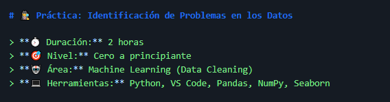
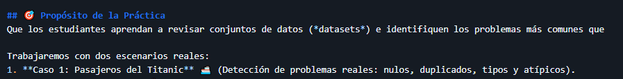

## TITANIC

## 1. Cargar el archivo CSV
## CODIGO
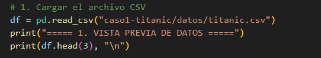
## TERMINAL
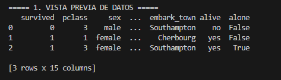

## 2. Conocer las dimensiones
## CODIGO
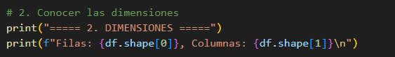
## TERMINAL
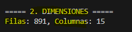

## 3. Revisar los tipos de datos
## CODIGO
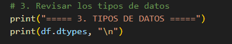
## TERMINAL
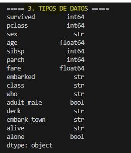

## 4. Identificar y contar datos nulos
## CODIGO
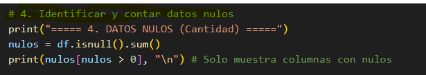
## TERMINAL
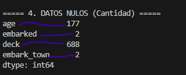

## 5. Calcular porcentaje de datos nulos
## CODIGO
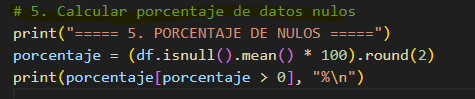
## TERMINAL
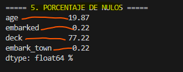

## 6. Identificar registros duplicados
#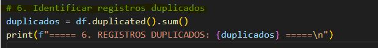
## CODIGO

## TERMINAL

## 7. Detección de Valores Atípicos (Outliers) en la Edad usando IQR
## CODIGO
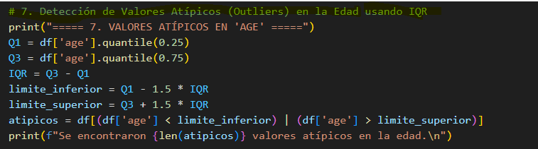
## TERMINAL
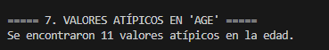

## 8. Visualización de datos nulos (Heatmap)
## CODIGO 
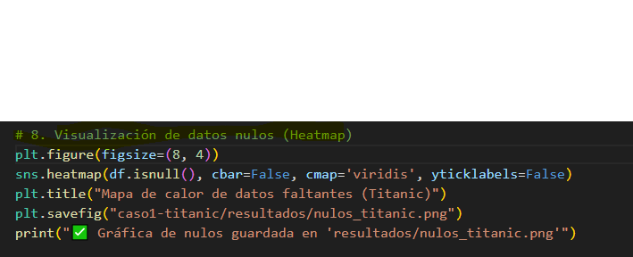
## RESULTADO
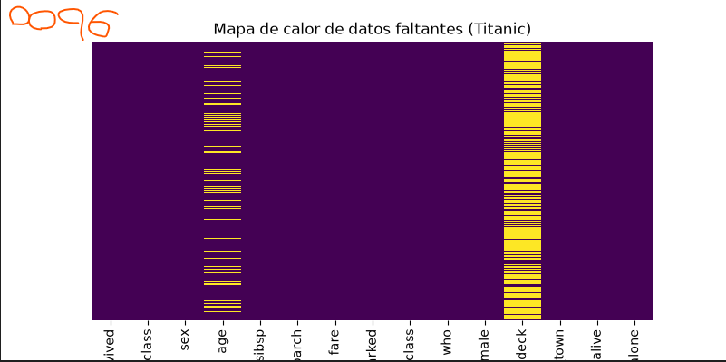

## 9. Limpieza básica (Copia para no alterar el original) Y 10. Guardar el dataset limpio
## CODIGO
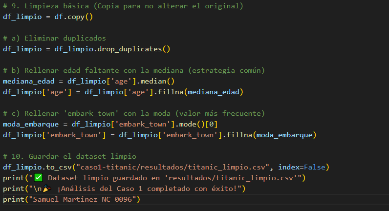
## RESULTADO
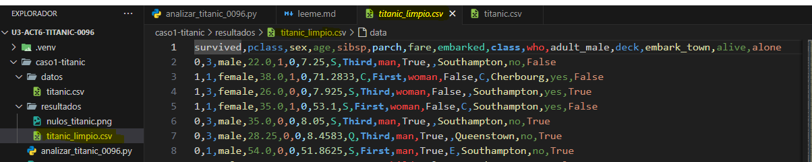